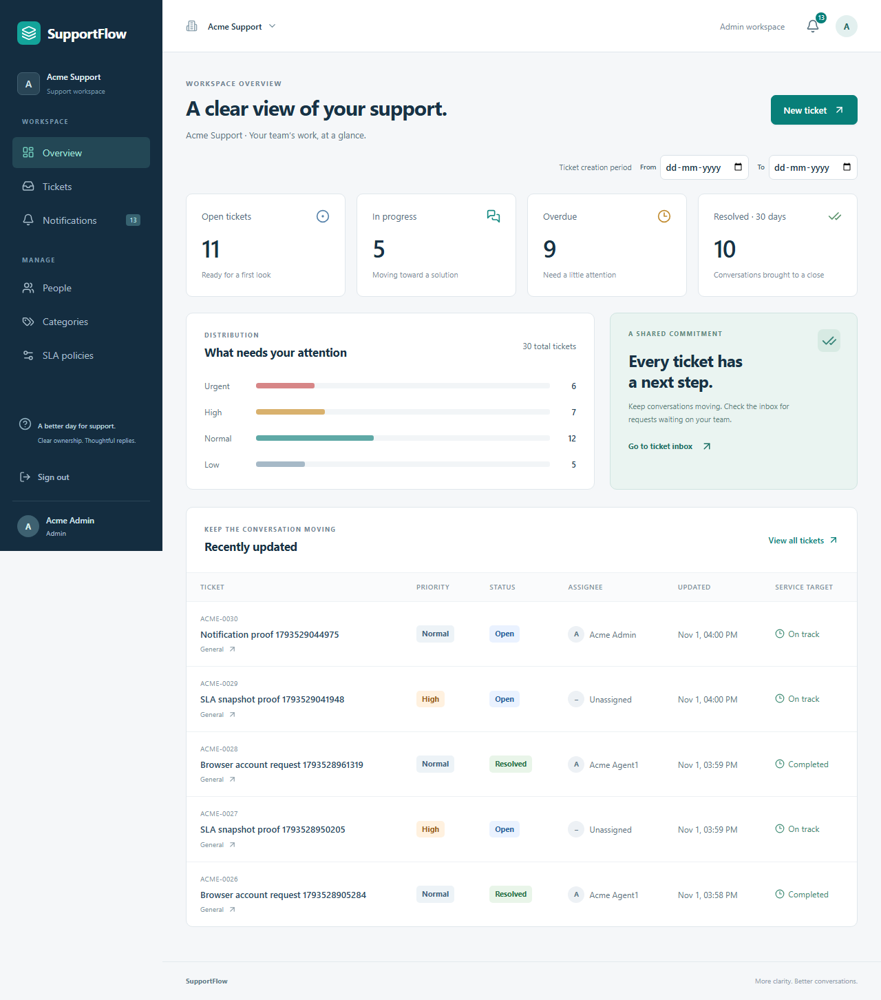
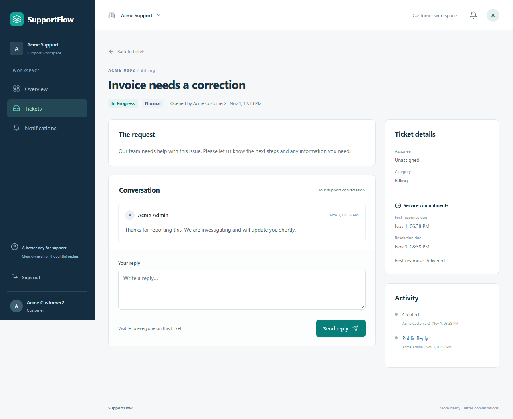

# SupportFlow

A working local customer support SaaS built with Ruby on Rails, React, PostgreSQL and Redis-backed Sidekiq. Admins manage workspaces, agents work the queue, and customers see only their own conversations.



## What works

- Cookie login/logout with Rails CSRF protection, session rotation and active organization switching.
- Admin, agent and customer permissions enforced in the API, including same-tenant ownership and cross-tenant denial.
- Ticket creation, safe concurrent numbering, assignment, lifecycle transitions, public replies, private staff notes and audit history.
- Search, filters, business-priority sorting, pagination and SQL-aggregated dashboards with creation-date filters.
- Admin member creation/access changes, category deactivation and SLA policy editing.
- Real periodic Sidekiq scanning and idempotent SLA/assignment notifications stored in PostgreSQL.
- Responsive React UI with desktop sidebar, keyboard mobile navigation, accessible labels, loading/error/empty states and draft-preserving refreshes.

This is a local portfolio application. No public deployment, production traffic, uptime or coverage percentage is claimed.

## Verified stack

Observed on Windows on **2026-11-01**. Both dependency lockfiles are committed; use them to reproduce the selected versions.

| Component | Verified version |
| --- | --- |
| Ruby / Bundler | 3.3.10 / 2.5.22 |
| Rails / pg | 7.2.4 / 1.7.0 |
| Sidekiq / sidekiq-cron | 7.3.10 / 2.4.0 |
| PostgreSQL / Redis | 18.3 / 7.2.8 |
| Node / npm | 22.14.0 / 11.19.1 |
| React / React Router | 19.3.1 / 7.18.5 |
| Vite / TypeScript / Tailwind | 6.4.5 / 5.7.3 / 3.4.19 |
| RSpec Rails / Vitest / Playwright | 7.1.1 / 4.1.12 / 1.64.1 |
| Prettier | 3.9.10 |

The application uses system fonts and bundled icons. No remote assets, paid infrastructure, Docker, hosted authentication, email service or external API key is required.

## Repository

```text
backend/          Rails controllers, policies, services, jobs, migrations, seeds, RSpec
frontend/         Vite React TypeScript UI, Vitest/RTL and Playwright journeys
scripts/          PowerShell setup/services/checks and real-worker verification
docs/             Architecture, API, decisions, demo script, results and screenshots
.github/workflows/ci.yml
```

Browser → Vite same-origin `/api/v1` proxy → Rails membership/role policy → transactional services → PostgreSQL. Rails enqueues ActiveJob → Redis → Sidekiq → scoped and locked PostgreSQL mutations. See [architecture](docs/ARCHITECTURE.md), [API](docs/API.md) and [decisions](docs/DECISIONS.md).

## Install on this Windows workspace

The application is a sibling of the instruction kit at **`U:\projects\supportflow`**. Portable Ruby, MSYS2 and Redis are already present in ignored `.local/`; PostgreSQL binaries are at `C:\Program Files\PostgreSQL\18\bin`. The setup uses its own loopback-only cluster on port **55432** and Redis on **56379**, without modifying the pre-existing PostgreSQL service on 5432.

Run in PowerShell:

```powershell
Set-Location U:\projects\supportflow
. .\scripts\env.ps1
.\scripts\setup.ps1
```

The script checks/creates the two local databases, runs `bundle install`, `ruby bin\rails db:prepare`, `ruby bin\rails db:seed`, `npm.cmd ci` and `npx.cmd playwright install chromium`. It does not install system software. Re-running seeds does not duplicate seed tickets, users or organizations. Set `PGBIN` first if PostgreSQL is in another directory.

Stop Vite before re-running setup: Windows locks its running esbuild binary during `npm ci`. The setup script detects a running SupportFlow Vite process and reports this before changing dependencies.

## Run on Windows

Start local services once:

```powershell
Set-Location U:\projects\supportflow
.\scripts\services.ps1 -Action Start
```

Use three separate terminals. Dot-source the environment in each Ruby terminal.

**Rails:**

```powershell
Set-Location U:\projects\supportflow
. .\scripts\env.ps1
Set-Location backend
ruby bin\rails server -b 127.0.0.1 -p 3000 -u webrick
```

**Sidekiq:**

```powershell
Set-Location U:\projects\supportflow
. .\scripts\env.ps1
Set-Location backend
bundle exec sidekiq -C config\sidekiq.yml
```

**React:**

```powershell
Set-Location U:\projects\supportflow\frontend
npm.cmd run dev
```

Open [http://127.0.0.1:5173](http://127.0.0.1:5173). Backend health is [http://127.0.0.1:3000/api/v1/health](http://127.0.0.1:3000/api/v1/health). Use the Vite URL for browser workflows so cookie/CSRF Host and Origin align. The Vite proxy deliberately has `changeOrigin: false`.

WEBrick is the verified development server. Windows Sidekiq logs that TTIN/TSTP signals are unsupported, but real jobs, cron registration, retry deduplication and database writes were verified. For production deployment, choose a supported OS/server and configure HTTPS, host allowlist and secrets; deployment has not been performed here.

Stop the three foreground processes with Ctrl+C, then stop only the project's local services:

```powershell
Set-Location U:\projects\supportflow
.\scripts\services.ps1 -Action Stop
```

## New Windows machine prerequisites

Install Git, Node 22 LTS, Ruby 3.3 with Devkit, PostgreSQL 14+ and Redis 6+. The tested Ruby archive is [RubyInstaller 3.3.10](https://github.com/oneclick/rubyinstaller2/releases/tag/RubyInstaller-3.3.10-1). On this machine, a portable MSYS2 toolchain was used for native gems after the silent installer was rejected by automatic approval review. Ruby archive SHA-256: `80203102617b216dc0bcdcc8c21cc3889aa3fde7f15860e2e22ee5487480f694`.

For the same portable layout, extract Ruby to `.local\rubyinstaller-3.3.10-1-x64`, MSYS2 to `.local\msys64`, and the [Redis Windows 7.2.8 MSYS2 archive](https://github.com/redis-windows/redis-windows/releases/tag/7.2.8) to `.local\redis`. Redis's Windows build is a community port, used only for this local verification. MSYS2 needs its initialized keyring plus `mingw-w64-ucrt-x86_64-gcc`, `make`, `mingw-w64-ucrt-x86_64-libyaml` and `mingw-w64-ucrt-x86_64-openssl` for the native Ruby gems. Standard Ruby+Devkit installation is also suitable; use its Ruby on PATH instead of the portable layout.

If using existing PostgreSQL/Redis rather than the portable service script, copy `.env.example` to `backend/.env`, supply your local PG settings/Redis URL and create `supportflow_development` and `supportflow_test`. Do not source `scripts/env.ps1` if you want different connection settings while `.local/pgdata` exists. `.env`, database files and local keys are ignored.

## Linux/macOS setup

These commands are provided for portability; execution was verified on Windows only. Install Ruby 3.3.10, Node 22, PostgreSQL 14+ and Redis 6+ with your OS package manager first. Start PostgreSQL and Redis using your OS services (`sudo systemctl start postgresql redis-server` on typical Ubuntu, or `brew services start postgresql@18` and `brew services start redis` on macOS with those formulae installed).

```bash
cd supportflow
cp .env.example backend/.env
# Configure backend/.env for your local PostgreSQL account and Redis.
createuser --createdb supportflow
createdb -O supportflow supportflow_development
createdb -O supportflow supportflow_test
cd backend
bundle install
ruby bin/rails db:prepare
ruby bin/rails db:seed
cd ../frontend
npm ci
npx playwright install chromium
```

In separate terminals, with your local PG/Redis environment available:

```bash
cd supportflow/backend
ruby bin/rails server -b 127.0.0.1 -p 3000 -u webrick
# Another terminal, same backend directory:
bundle exec sidekiq -C config/sidekiq.yml
# Another terminal:
cd supportflow/frontend
npm run dev
```

Database authentication is OS-specific; the `createuser` command must run as a PostgreSQL role allowed to create roles. Never weaken an existing database service's authentication to make the demo work. This workspace instead uses its own isolated development cluster.

## Local-only demo accounts

Default initial development password: **`DemoPass!12345`**. Set `DEMO_PASSWORD` before first seed to choose another; use the same value when running Playwright. Existing account passwords are not reset by re-seeding. Seeds refuse production and require an explicit password in test mode.

| Email | Acme role | Orbit role |
| --- | --- | --- |
| admin@acme.example | Admin | — |
| agent1@acme.example | Agent | — |
| agent2@acme.example | Agent | — |
| customer1@acme.example | Customer | — |
| customer2@acme.example | Customer | — |
| customer3@acme.example | Customer | — |
| admin@orbit.example | — | Admin |
| agent1@orbit.example | — | Agent |
| customer1@orbit.example | — | Customer |
| customer2@orbit.example | — | Customer |
| dual@demo.example | Admin | Customer |

Fresh seeds create 18 Acme tickets and 7 Orbit tickets with comments and events. Alerts are generated by the real worker. Browser tests and worker demos add additional labeled records to the development database.

## Test and demonstrate the worker

PowerShell checks, including PostgreSQL-backed RSpec, frontend tests, typecheck and build:

```powershell
Set-Location U:\projects\supportflow
.\scripts\check.ps1
```

With Sidekiq already running, verify actual Redis-backed execution and duplicate handling:

```powershell
Set-Location U:\projects\supportflow
. .\scripts\env.ps1
Set-Location backend
ruby bin\rails runner ..\scripts\verify_worker.rb
# Simpler manual demo that enqueues a scan:
ruby bin\rails demo:overdue
```

The integration verifier creates an overdue ticket, waits for real worker events, enqueues four duplicate breach jobs and checks counts. It writes `docs/evidence/worker.json`. It uses no inline/fake job adapter. SLA cron runs every five minutes, configurable via `SLA_SCAN_CRON`.

With Rails, Vite and Sidekiq all running, run browser journeys and regenerate screenshots:

```powershell
Set-Location U:\projects\supportflow\frontend
npm.cmd run e2e
npm.cmd run format:check
npm.cmd audit
```

Individual cross-platform checks:

```bash
cd backend
RAILS_ENV=test ruby bin/rails db:prepare
bundle exec rspec
ruby bin/rails zeitwerk:check
cd ../frontend
npm run typecheck
npm run build
npm test
npm run e2e
```

On PowerShell use `$env:RAILS_ENV = 'test'` before database commands, then `Remove-Item Env:RAILS_ENV` afterward. No authentication or forgery checks are disabled in request specs. RSpec uses real PostgreSQL; deterministic job specs use Rails's test queue, complemented by the separate real-worker integration check.

Latest observed gates: **29 RSpec examples, 9 Vitest/RTL tests and 8 Playwright journeys passed**. Typecheck, production build, Rails autoload and frontend formatting passed. `npm audit` found zero vulnerabilities. Coverage percentage and performance benchmarks were not measured. [Detailed evidence and complete acceptance checklist](docs/TEST_REPORT.md).

## Screenshots and walkthrough

Thirteen actual browser screenshots live in [docs/screenshots](docs/screenshots): login, dashboard, inbox, staff/customer detail and SLA settings at 1280×800 and 390×844, plus a 375px inbox. Screenshots are full-page captures and can be taller than the initial viewport.



See [three-minute walkthrough](docs/DEMO_SCRIPT.md). Raw local check output, browser results and worker evidence are in [docs/evidence](docs/evidence).

## CI and limits

[GitHub Actions](.github/workflows/ci.yml) configures PostgreSQL/Redis runner service containers and runs RSpec, autoload checks, npm ci, typecheck, build, Vitest and formatting. Local users do not need Docker. Workflow source exists and mirrors local commands; it has **not** run on GitHub because no remote repository or push was requested. Browser and real-worker checks are documented local gates rather than claimed CI coverage.

No required application feature remains blocked on this machine. Unverified areas: Linux/macOS execution, remote CI, production HTTPS/deployment, cross-browser testing outside Chromium, load testing, and measured test coverage. Attachments, outbound email, billing, realtime updates and public signup are intentionally out of scope. HTTP-only sessions contain identity only; no long-lived auth token is stored in localStorage. Development cluster trust authentication is restricted to local loopback and must not be used for production.
