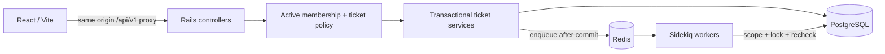

# Architecture

Rails is a full-controller application with cookie middleware and standard CSRF protection. Unused mail/storage/cable railties are not loaded. The local server uses WEBrick, a portable development server, rather than requiring a native Puma installation. Production deployment is out of scope.

Identity is global. Membership relates a user to an organization, with an active flag and organization-specific role. The API requires a validated organization header for domain resources. Current context is reset around every request. TicketPolicy narrows the organization scope to owned tickets for customers. Nested resources begin with an authorized ticket lookup. Notifications are narrowed to both organization and recipient, then current ticket visibility.

Users, organizations, memberships, categories, SLA policies, tickets, comments, ticket events, notifications and admin audit events use UUID keys. Composite foreign keys prohibit comment/event/notification ticket and ticket/category tenant mismatch. Active membership and staff eligibility are validated in the domain layer. PostgreSQL enforces uniqueness and required data. Organization row locks serialize numbering and membership management; ticket locks serialize comments, updates and breach processing.

Deadlines are immutable snapshots of policy at ticket creation. A public staff reply sets first_response_at only once. Internal notes never affect response clocks. SLA scan batches active tickets using deadline indexes. Breach workers reload by organization and ticket ID, lock and check current conditions, then atomically write an immutable breach event and deduplicated notifications. Assignment notifications skip stale assignments using the exact assignment event ID.

Indexes support organization/status/date inboxes, assignee work queues, customer ownership, deadlines and unread notifications. Listing preloads creator, assignee and category. Dashboard uses grouped SQL counts rather than Ruby materialization of the full ticket collection. Search uses bound ILIKE parameters; sorting uses a fixed whitelist. No application query interpolates user SQL.

React sends only relative API requests with credentials. The API client adds CSRF and selected organization headers. Organization changes remount the domain subtree; asynchronous hooks cancel obsolete requests, preventing results from the old organization appearing after a switch. The server remains the authorization boundary.

No attachments, hosted integrations, outbound email, billing, public signup or realtime subscriptions are included.
